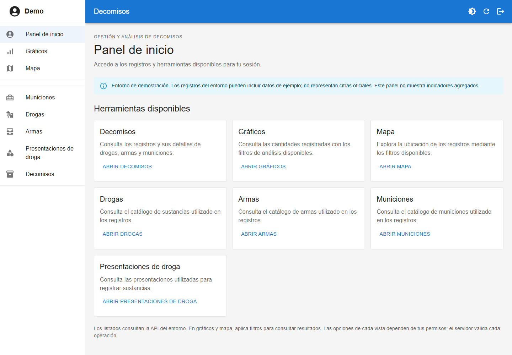
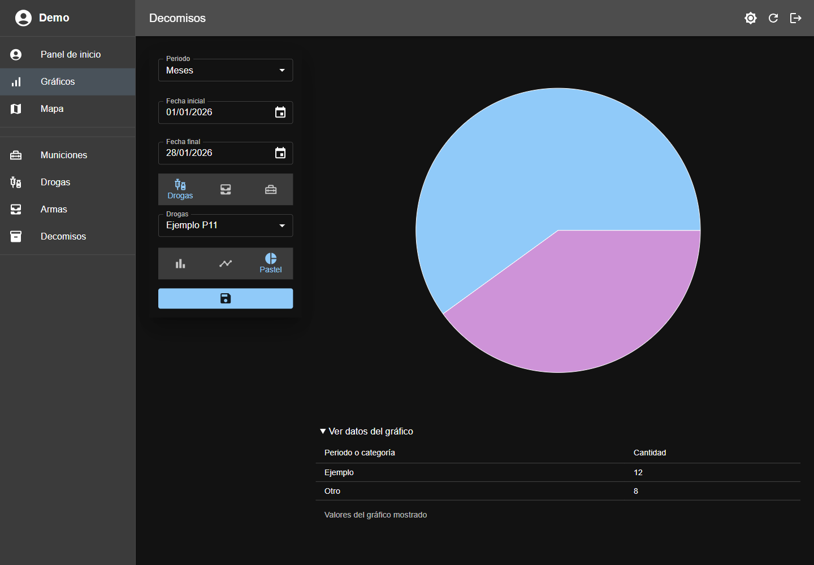
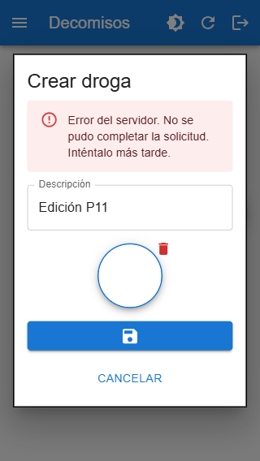

# Decomisos

Aplicación web para registrar decomisos de drogas, armas y municiones y explorar
sus cantidades y ubicaciones. Reúne el registro principal, sus elementos e
imágenes, los catálogos y las vistas de análisis en una misma interfaz.

Está orientada a quienes registran operaciones, a analistas que consultan sus
resultados y a administradores que gestionan catálogos y acceso. Cada sesión
dispone de las herramientas que permiten sus permisos efectivos.

## Funcionalidades

- Consulta, alta, edición y borrado de decomisos y sus registros asociados,
  con imágenes y ubicación seleccionable en mapa.
- Catálogos de drogas, presentaciones, armas y municiones; administración de
  usuarios, roles y permisos y consulta de actividad.
- Gráficos de barras, líneas o pastel y tabla de valores; ubicaciones y mapa de
  calor con filtros compartidos entre las vistas de análisis.
- Tema claro/oscuro, vistas adaptables a móvil y estados de carga, vacío, error
  y recuperación. El panel ofrece accesos según permisos, sin indicadores agregados.

## Vista del producto

Capturas locales verificadas visualmente, con sesión y datos ficticios y API
simulada. Sus cifras no son estadísticas oficiales ni acreditan un despliegue
público. Procedencia en los informes de
[producto](docs/verification-product-p10-2026-11-12.md) y
[accesibilidad](docs/verification-accessibility-p11-2026-11-12.md).

**Panel de inicio:** accesos a registros y análisis según permisos.



**Análisis en tema oscuro:** filtros y tabla con los mismos valores del gráfico.



**Recuperación en móvil:** la edición se conserva tras un rechazo del servidor.



## Demo y recorrido

**Demo pública pendiente de comprobar.** Al 12 de noviembre de 2026, el
propietario confirmó que aún carece de producción. La integración y los datos
de demostración están verificados en el entorno local descrito abajo.

El acceso precargado del login se conserva por decisión del propietario para
facilitar las visitas. No se reproducen credenciales aquí. Requiere que la API
configure esa cuenta y sus permisos; instalar el frontend no crea cuentas ni
datos. El acceso local comprobado permite también escrituras administrativas;
el recorrido propuesto usa consultas y evita modificar registros ajenos.

1. Iniciar sesión y abrir **Decomisos** desde el panel.
2. En el entorno preparado, ordenar por `id` descendente y abrir el detalle de
   un registro `DEMO_P12_V1`. Desplegar sus drogas, armas y municiones.
3. Abrir **Gráficos**, elegir Meses, Drogas y Barra. Usar del 01/11/2026 al
   30/11/2026 y seleccionar solo `DEMO_P12_V1 Sustancia A ficticia`. Aplicar
   filtros: el conjunto preparado devuelve 5. Consultar la tabla del gráfico.
4. Navegar a **Mapa** en la misma sesión: conserva los filtros aplicados y
   muestra dos puntos de demostración. Terminar con **Cerrar sesión**.

La [guía de demo](docs/demo-guide.md) detalla permisos, recorrido, preparación
con datos ficticios y restablecimiento. Se prepararon doce registros persistentes
en la API local; cada entorno requiere su propia preparación e inventario.
Los datos anteriores no tienen autenticidad acreditada. Usar los catálogos
`DEMO_P12_V1` para evitar incluirlos en el recorrido.

## Stack

SPA con TypeScript estricto y Vite. Versiones resueltas en
[package-lock.json](package-lock.json):

| Área | Tecnologías |
| --- | --- |
| Interfaz y rutas | React 19.3.1, React Router 7.18.5, MUI 6.4.7 y Emotion |
| Datos y estado | TanStack Query 5.107.1, Redux Toolkit 2.6.1, React Redux, Axios 1.21.0 |
| Formularios | React Hook Form 7.55.0, Zod 4.6.7, resolvers y Day.js |
| Visualización | Recharts 3.3.0, React Leaflet 5.0.0, Leaflet 1.9.4 y leaflet.heat |
| Desarrollo | TypeScript 5.8.2, Vite 8.3.5, ESLint y runner de pruebas de Node |

El backend Laravel se integra por HTTP y vive fuera de este repositorio.

## Arquitectura y decisiones

Los dominios están en `src/modules/`: componentes, hooks, contratos, `services/`
y `queries/` según sus necesidades. Cada estado tiene un propietario:

| Responsabilidad | Propietario y motivo |
| --- | --- |
| Datos remotos | **Query** administra resultados, carga, errores, caché e invalidación. Las claves distinguen argumentos y padre de sublistas. Evita otra copia de resultados en Redux. |
| Sesión y filtros | **Redux** contiene solo `auth` y `analysisFilters`: sesión única y filtros serializables compartidos entre mapas/gráficos. La edición del filtro permanece en el formulario hasta Aplicar. |
| Contratos HTTP | **Services** serializan parámetros y JSON/multipart, adaptan respuestas y validan IDs. Propagan rechazos y aceptan señales; no navegan, muestran mensajes ni administran caché. Query los consume directamente; los thunks de auth coordinan sesión. |
| Edición y pantalla | **React Hook Form** posee valores/validación; los hooks coordinan selección, diálogos y navegación. Las recargas no deben sobrescribir la edición en curso. |

Las escrituras exitosas invalidan las consultas afectadas. La política común
usa 30 segundos de vigencia, cinco minutos de retención de consultas inactivas
y ningún reintento automático; permite revalidar datos obsoletos al montar,
enfocar o reconectar. Véase [queryClient.ts](src/queries/queryClient.ts).

**Permisos.** [access.ts](src/modules/auth/access.ts) centraliza permisos y
sus dependencias. Guards, menú y acciones consultan la sesión Redux, sin
conceder acceso por nombre de rol. Los guards preceden a las vistas con
consultas; el servidor autoriza cada operación. Un 403 conserva el rechazo
y puede activar una comprobación acotada con `/refresh`, sin repetir la operación.
Política y límites en el [informe de autorización](docs/verification-access-control-2026-11-10.md).

**Formularios ante errores.** Carga inicial, recarga y envío tienen estados
separados. Un guardado rechazado muestra el error y conserva campos, archivos
y diálogo para corregir o reintentar. Cierre y navegación de éxito esperan el
resultado. Los cambios de identidad o permisos sí pueden retirar la vista para
proteger la sesión; evidencia en [accesibilidad](docs/verification-accessibility-p11-2026-11-12.md).

**Sesión y cancelación.** El [middleware](src/store/sessionMiddleware.ts)
retira el transporte, cancela consultas y limpia Query ante fronteras de identidad
o autorización. Las lecturas reciben la señal de Query y las mutaciones protegen
callbacks frente a respuestas tardías. Un refresh idéntico conserva formularios;
los filtros se mantienen para la misma cuenta. Cancelar transporte o limpiar
caché no deshace una escritura aceptada por el servidor. La geocodificación
externa usa un cliente separado sin credenciales del backend.

**Carga diferida.** Las rutas, gráficos y mapa se importan bajo demanda;
Leaflet y su CSS quedan fuera de la entrada inicial. Suspense presenta la carga
y una frontera de errores ofrece recuperación ante fallos de render/importación.
Evidencia en [carga diferida](docs/verification-lazy-routes-2026-11-07.md),
[rendimiento](docs/verification-lint-performance-2026-11-09.md) y
[recuperación de vistas](docs/verification-view-errors-p08-2026-11-12.md).

## Arranque local

Requiere Node y npm compatibles con el lockfile. CI fija Node **26.13.1**;
la validación local documentada usó **26.13.0** y npm **11.20.0**. La ejecución
exacta del runner de GitHub sigue pendiente. También requiere API Laravel,
medios públicos y cookies/CORS configurados para el origen del frontend;
este workspace no incluye la instalación del backend.

Desde la raíz:

```sh
npm ci
```

Copiar `.env.template` a `.env` (`Copy-Item .env.template .env` en PowerShell,
si todavía no existe) y revisar los valores para el backend disponible:

```dotenv
VITE_API_URL=http://localhost/api
VITE_LOCAL_PHOTOS_URL=http://localhost/storage
```

Son las bases confirmadas en el entorno local documentado. La segunda resuelve
referencias relativas de imágenes; no asumir `/storage` para otro servidor.
Las variables `VITE_` son públicas y se incorporan al compilar: no incluir
secretos. Reiniciar Vite al cambiarlas en desarrollo; para producción generar
otro build. Véanse la [plantilla](.env.template), la
[guía de despliegue](docs/deployment-guide.md) y las
[reglas de entorno de Vite 8.3.5](https://github.com/vitejs/vite/blob/v8.3.5/docs/guide/env-and-mode.md).

```sh
npm run dev -- --host localhost --port 5174 --strictPort
```

Abrir `http://localhost:5174`. El puerto 5173 está reservado al backend en el
entorno documentado. Comprobar disponibilidad antes de iniciar; `--strictPort`
evita cambiar de origen silenciosamente. En PowerShell usar `npm.cmd` si se
bloquea `npm.ps1`.

## Verificación

```sh
npm test
npm run lint -- --max-warnings=0
npm run build
npm run preview -- --host localhost --port 4173 --strictPort
```

Preview sirve `dist` en `http://localhost:4173` para revisión local; sesión y
datos siguen necesitando API y un origen permitido por ella. Las pruebas Node
usan transporte controlado y el cargador SSR de Vite, sin backend real.
Los recorridos de `tests/browser/` se ejecutaron con Playwright MCP; todavía
no constituyen una suite E2E autónoma con Playwright Test.

La última verificación documentada del mismo código funcional aprobó **261
pruebas**, lint sin advertencias y build; alcance en la
[guía de despliegue](docs/deployment-guide.md). Es evidencia local, no un
porcentaje de cobertura ni una ejecución nueva por editar esta portada.
El [workflow](.github/workflows/deploy-frontend.yml) exige instalación, pruebas,
lint y build en PR/push; el despliegue depende de esos checks y se limita al
push en `main`. Su ejecución en GitHub y la entrega pública están pendientes.

## Aportación técnica documentada

El trabajo presentado es la evolución de un frontend existente: separación de
contratos por dominio, migración de datos remotos a Query conservando Redux
para sesión/filtros, protección frente a respuestas tardías y conservación de
la edición ante errores. Incluye permisos visuales centralizados, análisis con
filtros compartidos, carga diferida y mejoras representativas de teclado, foco
y móvil. Código, pruebas e informes permiten revisar las decisiones y sus límites.

La continuidad registra decisiones del propietario y trabajo asistido por agentes;
no permite atribuir autoría exclusiva de toda la aplicación. El propietario
informó de cambios de autorización en Laravel, contrastados después con pruebas
HTTP; ese código backend no está aquí. Evidencia en
[backend real](docs/verification-backend-real-2026-11-10.md) y
[contratos de identificadores](docs/verification-identifiers-p02-2026-11-11.md).
No se afirma experiencia de operación en producción ni mejoras porcentuales
sin medición comparable.

## Límites actuales y documentación

- Producción, HTTPS, cookies/CORS públicos, recargas internas y entrega de
  chunks/medios pendientes de verificación. Un build correcto no acredita
  hosting ni configuración efectiva; revisar la [guía de despliegue](docs/deployment-guide.md).
- Las sublistas vacías mantienen una adaptación limitada: faltan metadatos
  completos en el contrato backend. La eliminación física de imágenes sigue
  sin acreditarse; el refresh anónimo sin `Accept: application/json` conserva
  un ajuste Laravel pendiente. Detalles en [backend](docs/verification-backend-real-2026-11-10.md)
  y [autorización](docs/verification-access-control-2026-11-10.md).
- La demo pública, su inventario y el ensayo completo de restablecimiento siguen
  pendientes. Teselas y geocodificación dependen de servicios externos.
  Procedimiento en la [guía de demo](docs/demo-guide.md).
- Accesibilidad y permisos tienen comprobaciones representativas: no acreditan
  conformidad WCAG completa, todos los dispositivos ni todos los perfiles reales.
  Los informes separan simulaciones de pruebas con API local.

Decisiones y verificaciones completas: [arquitectura y plan](docs/refactor-plan.md),
[estado técnico](docs/refactor-progress.md), [estado del portafolio](docs/portfolio-progress.md)
y [herramientas de desarrollo asistido](docs/ai-tooling.md).
